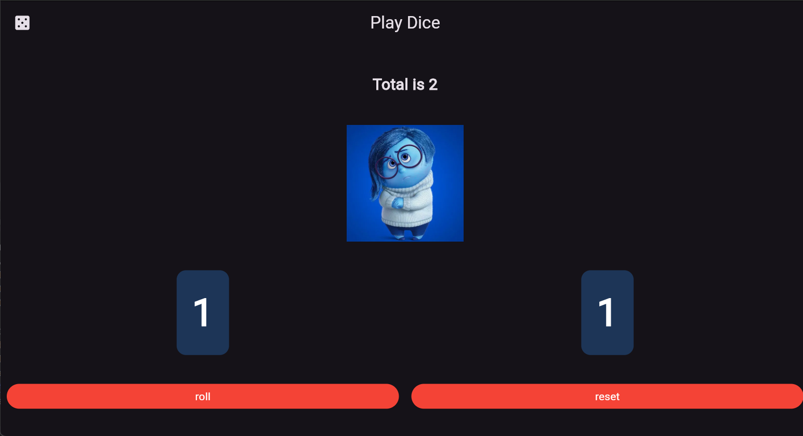

# 🎲 Dice Game App

An interactive Flutter-based game developed for the Mobile Development course.

---

## 📸 App Preview

  

---

## 🌟 Key Features

* 🎲 **Random Dice Roll:** Generates two independent random numbers from 1 to 6 upon interaction.
* 🎯 **Dynamic Feedback:** Displays a cheerful reaction image if the total sum is 10 or greater, and a different state image otherwise.
* 🔄 **Reset Option:** Easily resets both dice values back to their default starting value of 1.
* 🎨 **Modern Dark UI:** Styled with a clean, modern dark theme designed for optimal user experience.

---

## 🛠️ Technologies Used

* **Framework:** Flutter
* **Language:** Dart
* **Architecture:** Stateful Widgets